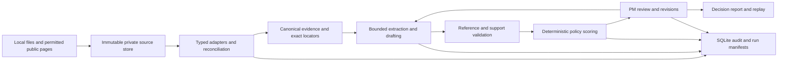

# Development plan

Repository analysis: 10 October 2026. This plan maps the current checkout to the tasks in [TASKS.md](TASKS.md); it supplements the proposed [24-hour schedule](docs/IMPLEMENTATION_PLAN.md). No application task is marked complete by this analysis.

## Current implementation

The repository is a preparation and coding handoff pack, not a runnable product. Its objective is an evidence-grounded workbench for successor-vehicle requirements: start with G60, keep G68 scope distinct, and use F70/G70 to evaluate transfer. Accuracy, reproducibility and PM control take precedence over UI polish.

| Area | What exists | What remains |
|---|---|---|
| Product and design | Strategy, data audit, architecture, contracts, scoring, review, evaluation and demo documents | Executable services implementing those contracts |
| Local inspection | `inspect_supplied_data.py`, `profile_feedback.py`, `validate_preparation.py` | Production adapters, reconciliation artifacts and regression tests |
| Core | `src/bmw_pm/AGENTS.md` | Package, typed models, pipeline and CLI |
| Tests and UI | Directory-specific instruction files | Fixtures, acceptance tests and Streamlit application |
| Model integration | Extraction, drafting and argument-review prompt specifications | Provider adapter, redaction, bounded calls, validation and cache |
| Public evidence | Five curated entries in `research/web_evidence_seed.jsonl` | Permitted source snapshots, verified locators and applicable claims |
| Runtime setup | Git ignore rules for private data and generated artifacts | Dependency manifest/lockfile, environment template and install instructions |

The supplied workbooks, PDFs and local inspection reports are absent from this checkout. Counts in [DATA_AUDIT.md](docs/DATA_AUDIT.md) describe earlier inspection and were not independently reproduced here. The README's inspection examples use another machine's Windows paths; replace them with portable, user-supplied input paths during bootstrap.

The existing scripts preserve and inspect local sources. The archive inspector limits expansion, rejects traversal/unexpected extensions and refuses changed raw-file overwrites. The feedback profiler groups IDs for descriptive diagnostics. The preparation validator checks document links, hashes, workbook counts, survey distributions and illustrative arithmetic. None implements the proposed application pipeline or measures model quality. Avoid importing the profiler as a library: it performs file reads and report writes at module level.

## Intended architecture

The proposed default is a modular Python core with SQLite persistence and a thin Streamlit UI. These are design choices, not installed dependencies. Keep UI and provider details outside domain logic.

| Proposed module | Responsibility and boundary |
|---|---|
| `contracts.py` | Pydantic domain models and generated JSON Schema, following [DATA_CONTRACTS.md](docs/DATA_CONTRACTS.md) |
| `ingestion/` | Source inventory, feedback/study/sales parsing, verified equipment facts and bounded web imports; no ranking |
| `evidence/` | Reversible transformations, locators, span resolution, scope filtering, origin-family handling and retrieval of support/counterevidence |
| `intelligence/` | Provider-neutral extraction, grouping, drafting and critique; no approval or score arithmetic |
| `decision/` | Pure scoring, missingness bounds and sensitivity under a versioned policy/profile |
| `review/` | Allowed actions, immutable revisions, stale-write detection and challenge resolution |
| `storage/` | SQLite repositories/migrations; atomic revision, decision and audit writes |
| `evaluation/` | Frozen splits, baseline comparison, quality metrics and performance reports |
| `cli.py` and `ui/` | CLI runs bounded jobs; UI calls services and inspects completed artifacts |

The central objects are source documents and locators, canonical feedback records with separate legacy annotations, validated signals, requirement revisions, policies/profiles, score snapshots, decisions, audit events and run manifests. Implement only the contracts needed for each slice rather than creating empty modules for the entire diagram.

Important boundaries:

- Group feedback by source hash + ID. The documented 13,771 rows represent 10,128 feedback IDs, not independent customers; extra labels must not increase recurrence.
- Preserve raw bytes/values and transformation lineage. Keep unknown, zero and not-applicable distinct; `BEVE` normalization remains an explicit assumption.
- Validate reference resolution deterministically; separately assess whether evidence entails a claim. A valid source ID is insufficient.
- Keep evidence strength, customer value, feasibility and cost separate. Unknown criteria yield scenario bounds without renormalizing known weights.
- Persist exact requirement/policy/profile revisions. Model output cannot approve a requirement; edits and new evidence cannot inherit old approval silently.
- Version inputs, code, schemas, prompts and returned model identity. Label cached inference replay explicitly.
- Keep private inputs, redaction mappings, responses, databases and exports outside Git. Audit covers application actions, not arbitrary OS access.

## Next implementation steps

### 1. Establish a deterministic runnable foundation — T01

Create `pyproject.toml`, a reproducible lockfile, an installable `bmw_pm` package, `.env.example` without secrets and portable setup instructions. Define the first Pydantic contracts: source/locator, feedback/annotation, run manifest and audit event. Add minimal SQLite persistence with foreign keys and transaction boundaries. Read the relevant directory `AGENTS.md` before changing core, tests or UI.

Build a synthetic fixture with repeated annotations, mixed sentiment, missing metadata and a conflicting ID. Provide a CLI path that ingests it and resolves an original row citation without inference. Record source hash, schema/parser versions, accepted/quarantined counts and run identity.

**Acceptance:** a fresh environment can install the package and execute the documented fixture command; repeated import creates no duplicate evidence; every source unit is accepted or quarantined; source locators resolve. Keep synthetic outputs explicitly labelled.

### 2. Normalize supplied evidence and freeze evaluation splits — T02–T04

Obtain the private inputs through the authorized team channel and rerun the inspection/validation scripts. Implement feedback grouping while retaining every annotation and row locator; quarantine conflicts and log reversible cleaning. Add redaction with a private mapping before any hosted inference.

Parse the two study layouts separately, sales into long-form records and 10–20 manually verified equipment facts with exact page/table scope. Preserve unknown study sample sizes, combined G60/G68 sales and future-scenario status. Do not infer powertrain sales or equipment fitted to an undated US vehicle.

Freeze hashes and grouped splits before prompt tuning: 60 G60 development, 30 blind G60 test, 15 F70 transfer and 15 G70 transfer records. Keep annotations and probable repost families together. Independently annotate the initial 120-record set, double-label at least 30 and report disagreements; supplied labels are not gold truth.

**Acceptance:** reproduce the documented 10,128 IDs and 13,771 annotations, 185 mean cells and 206 study distributions, or explain discrepancies; zero silent drops. Duplicating annotation rows 100 times leaves per-need counts unchanged. Split leakage checks pass. Input ambiguity remains explicit.

### 3. Implement extraction and grounding — T05

Start with a deduplicated keyword/taxonomy baseline. Add a single provider-neutral structured extraction adapter using the existing prompt specifications. Consult official provider documentation when implementing current APIs. Bound payloads, concurrency, retries, repair attempts and spending; record failures and abstentions, returned model identity, prompt/schema hashes and timings.

Validate schemas, references, exact evidence spans and vehicle context before accepting signals. Preserve multiple needs and both praise and complaints. Treat embedded instructions as evidence text with no execution privileges. Cache validated outputs using content, model, prompt, schema and profile identity.

**Acceptance:** synthetic injection, unknown-input, multiple-need and mixed-sentiment cases pass. Development results report quality and coverage against the baseline. Benchmark 20–50 development records before expanding inference. Do not tune on blind or transfer sets.

### 4. Complete requirement drafting and deterministic ranking — T06–T07

Retrieve support and counterevidence with scope filtering. Draft customer outcomes, alternatives, assumptions, missing evidence and proposed acceptance methods; leave unsourced technical targets and feasibility pending. Reject promotion of unsupported hypotheses as grounded recommendations.

Implement the anchored I/R/S/O value model from [DECISION_ENGINE.md](docs/DECISION_ENGINE.md), preserving raw counts and denominators beside mapped scores. Begin with visibly unapproved `exploratory_equal_v1`; keep policy weights configurable. Return criterion contributions, lower/upper scenario bounds, coverage and unresolved comparisons. Keep cost/feasibility outside the value sum.

**Acceptance:** fixture arithmetic reproduces 56.25/62.5 and 67.5/55.0 under the documented policies; an unknown O yields [50,75]. Frozen inputs reproduce scores exactly. Duplicate annotations cannot change ordering; policy changes update scores and rationale from the same snapshot. Missing China evidence remains unknown.

### 5. Finish the first end-to-end review slice — T08–T09

Take a small G60 packet containing positive, negative, mixed and ambiguous evidence through extraction, drafting, validation and scoring. Implement PM approve/reject/edit/challenge/defer actions with exact revisions, expected-revision checks and idempotency keys. Commit revisions/decisions and audit events atomically. Persist evidence/view/export events without raw personal text.

Build a thin UI only once this service path works. Show evidence drill-down, denominator/coverage, opposing claims, assumptions, score contributions and feasibility status. Demonstrate one challenge and a revised requirement, preserving the earlier decision. Export reviewed scope with a version manifest and neutralized spreadsheet formula-like text.

**Acceptance:** editing approved revision 1 creates revision 2 requiring review; stale writes fail; transaction failures leave no partial decisions; historical replay reproduces exact artifacts/scores without model calls. UI labels local role selection and replay limitations accurately.

### 6. Add bounded enrichment and a second evidence cycle — T10

Implement permitted public-source collection once source contracts exist; it can proceed before the review UI and must feed the final argument. Start with 3–4 useful imports from the curated seeds. Save snapshot hashes, timestamps, locators, origin families and cleaning history. Enforce domain/network restrictions, redirect validation and byte/time limits. Seeds require refetch and locator validation before serving as grounded application evidence.

Import one real new source, identify affected requirements and produce a new review snapshot. Flag mismatched markets, model years and methods rather than computing unsupported competitive gaps. Keep derived facts from repeated URLs in one origin family.

**Acceptance:** an imported fact reaches an actual requirement with a resolvable locator; repeated sources do not multiply corroboration; scope mismatches are visible; contradictory evidence reopens review while retaining history. Call this an ingestion sequence, not a temporal customer trend.

### 7. Evaluate, freeze and present — T11–T12

Run the frozen G60 test and F70/G70 transfer sets plus the mandatory adversarial cases in [EVALUATION.md](docs/EVALUATION.md). Compare the keyword baseline, bounded single-call baseline and validated pipeline on identical packets. Evaluate citation entailment independently and publish numerators/denominators, coverage, annotation reliability and subgroup gaps.

Measure cold/replay p50/p95 latency, failure/retry rates and tokens; report monetary cost only with a timestamped price basis. Extend to a disclosed 200-record efficiency run if budget permits. Keep full-corpus processing optional until measured throughput supports it.

**Acceptance:** dataset reconciliation, citation validation, duplicate invariance, unseen-model, unknown-input, revision and replay checks all have recorded outcomes. Publish `runs/<run_id>/metrics.json` and an evaluation report, including missed targets. The provisional goals (e.g. macro F1 ≥0.80 and entailment ≥95%) remain goals until measured. Freeze an offline replay and decision export for a five-minute demo with explicit limitations.

## Delivery order and scope control

Follow the existing 24-hour schedule: foundation 0–2 h; adapters/splits 2–5 h; extraction 5–9 h; drafting/scoring 9–12 h; review/UI 12–15 h; enrichment/transfer 15–18 h; evaluation 18–21 h; demo freeze 21–24 h. These are planning estimates measured from implementation start.

The first implementation task is T01's deterministic source-to-citation slice. The first complete product milestone is the small G60 packet through a PM challenge and replay. Update `TASKS.md` after each task with changed files, commands, results, artifact/run IDs and unresolved limits; do not check boxes solely because code exists.

If time slips, reduce source breadth, card count and UI detail. Preserve grounding, missingness, PM control, live model evidence, frozen evaluation and replay. Defer embeddings, full PDF automation, fine-tuning, autonomous-agent orchestration, cloud deployment, enterprise identity and physical vehicle simulation until an evidenced need exists.

## Verification of this repository analysis

- Inspected repository files, clean initial Git status, all three inspection scripts and the relevant design/contracts/evaluation documents. Confirmed no application code, dependency manifest or test implementation is present.
- `python --version` and `python scripts/validate_preparation.py`: unavailable because `python` is not installed as a command.
- `python3 --version`: Python 3.12.3.
- `python3 scripts/validate_preparation.py`: blocked at import by missing `openpyxl`; private raw files/local profiles are also absent. No dependencies were installed for this documentation task.
- Documentation link validation and script syntax compilation are recorded in the task response after writing this file.

Dataset reconciliation and application citation, duplicate-invariance, unseen-model, unknown-input, revision and replay checks were not run successfully in this analysis. The application and its fixtures do not yet exist; no model accuracy or performance is claimed.
