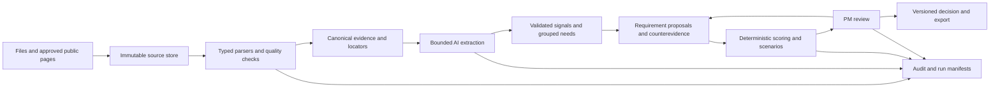

# MVP architecture

The prototype uses the following architecture; future capabilities are identified below. Use a modular Python application, SQLite, and a thin Streamlit interface. These are local prototype defaults, not a claim that the stack is optimal for production. Choose supported library versions at implementation time and record them in a lockfile.

## Flow

## Implemented layout

See the [repository map](../README.md#repository-map) and [module guide](../src/bmw_pm/README.md). Search, acquisition and cleaning live in `src/bmw_pm/data_pipeline/`; AI extraction lives in `intelligence/`; deterministic requirement consolidation and scoring live in `decision/`; PM actions live in `review/`; SQLite persistence and audit live in `storage/`. `pipeline.py` composes these responsibilities and the CLI/UI call the services.

The web and YouTube collectors are optional standalone tools with separate dependency environments. Their outputs are not yet imported into the core evidence/requirement graph. Do not interpret the flow above as a claim that automated web integration, critique or reviewed export is implemented. Dedicated evidence retrieval and evaluation packages should be added when there is tested functionality to put in them.

## Module responsibilities

**Ingestion** never ranks requirements. It exposes typed records, source locators, quality findings and reconciliation counts. Use separate parsers for actual study formats; do not feed spreadsheet screenshots to a language model when cell structure is accessible. Use a verified equipment-fact subset before attempting full matrix parsing.

**Evidence retrieval** filters scope before semantic matching. Start with exact IDs, taxonomy/keyword retrieval and SQLite text search. Add embeddings only if retrieval evaluation shows missed paraphrases. Store support and counterevidence; retrieval should not search only for confirmation. Source chunks retain locators and origin-family links.

**Intelligence** has a provider-neutral `extract`, `group`, `draft`, `critique` interface, each with a bounded input schema. Do not create a swarm of autonomous agents. Candidate grouping can use a controlled taxonomy with an explicit `other` category; splitting a theme by use case is often more useful than a sophisticated clustering algorithm.

**Decision** is a pure function of validated inputs, scope and policy. It has no network calls and no access to raw LLM prose as numeric truth. Same frozen inputs must reproduce score contributions exactly. Handle unknowns explicitly and preserve ties.

**Review** manages requirement revisions and PM actions. **Storage** persists those changes and audit events in one transaction. **UI** displays results and calls these services; it cannot change scoring arithmetic or mutate approval fields directly.

## Model integration and performance

Select an accessible structured-output model through a development-set comparison; do not choose on a marketing claim or claim accuracy before running it. Keep extraction and synthesis model IDs configurable. Begin with one provider and one model to reduce failure paths; use a stronger verifier only if measured benefit justifies latency and cost.

Pin a provider-supported snapshot where available and record the model identity actually returned. Record prompts, schemas and supported decoding parameters; do not assume temperature=0 guarantees deterministic inference. Exact reproducibility comes from replaying cached validated outputs.

Cache keys include raw/redacted content hash, model identity, prompt/schema versions, scope/profile version and extraction settings. Scoring-policy changes invalidate score snapshots but need not invalidate unrelated extracted text. Changed evidence or prompts invalidate dependent artifacts. Store a dependency graph sufficient to identify affected requirements.

Measure throughput on 20–50 records before running a larger batch. Strip redundant annotation copies, use bounded chunks, cache repeated content, apply concurrency limits and backoff, and record skipped/failed inputs. Cap retries and runtime; one repair attempt for invalid structured output is a reasonable starting policy. A failed call must become a visible failure/abstention, never a fabricated neutral signal.

Cost reporting uses measured tokens and a timestamped provider price configuration, not guessed dollars. Without known pricing report tokens. Record end-to-end latency including queueing, parsing, model and validation time, with cached replay separated from cold execution.

## Persistence and service operations

SQLite tables should follow the contracts, using normalized relationships for evidence and revisions and JSON for small versioned payloads. Enable foreign keys. Use transaction-safe inserts for revision + decision + audit event; unique request IDs support idempotency. Enforce optimistic concurrency with expected_revision.

Core service operations: `ingest_source`, `inspect_quality`, `extract_signals`, `propose_requirements`, `score_scope`, `compare_scenarios`, `review_requirement`, `ingest_new_evidence`, `replay_snapshot`, `export_reviewed_requirements`. A standalone HTTP API is optional; do not build FastAPI merely to connect a local UI to functions in the same process.

For a small demo, run long jobs through a CLI and load completed results into the UI. Add a bounded background job runner only if needed. An interrupted job persists progress and can resume from record IDs. Do not hold a UI session open as the only copy of decisions.

## Untrusted inputs and privacy

External sources have no authority to modify prompts, scores or application permissions. Treat text as quoted data in a constrained extraction task, with no tool execution privileges. Validate URLs through the collector, not through model-requested arbitrary fetches.

For the collector, allow approved HTTP(S) domains, reject local/private/reserved network destinations including after redirects, cap bytes/time/redirects, and do not bypass authentication, CAPTCHAs or paywalls. Retain only permitted material needed for evidence. Archive extraction must reject traversal and excessive expansion.

Redact customer names/contact details before external inference. Source A–D records are not guaranteed anonymous merely because names are absent from columns; narrative text can contain names. Keep private raw data and the de-identification map local. Keep API keys in environment variables; never in prompts, exports or audit payloads.

## Explicit production gaps

Local actor selection is adequate to demonstrate workflow but is not authenticated enterprise identity. SQLite application logs do not capture arbitrary filesystem access. A hash chain is not tamper-proof against an administrator who can rewrite the database. Enterprise deployment needs real authentication/authorization, durable external audit anchoring, retention policies, secure storage and operational monitoring; defer these while accurately describing the prototype.
