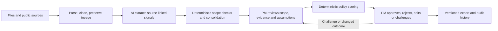

# Repository cleanup and challenge assessment

This review concerns the repository as implemented, assessed against the supplied challenge brief. It does not claim measured model quality, verified source entailment or a production-complete audit system. The file-by-file map is in [FILE_INVENTORY.md](FILE_INVENTORY.md).

## Changes made

All search, retrieval, parsing and cleaning code is grouped in `src/bmw_pm/data_pipeline/`. Workbook adapters moved from `ingestion/`; the public-web and YouTube collectors moved from the repository root into that module. Their script-local commands, dependencies, configuration and relative data paths remain intact. Collector directories move together, including any local ignored artifacts; new commands use the new paths.

Deterministic requirement consolidation moved from `intelligence/requirements.py` to `decision/requirements.py`. Scoring remains in `decision/scoring.py`. Intelligence now owns signal extraction, including the explicitly labelled offline fallback. Updated the core, CLI, UI and test imports. These internal Python import paths changed; external scripts importing the old paths must be updated.

Added module README files, a repository map, useful module docstrings and comments explaining unique-record counting and the model/decision boundary. Replaced the architecture document's obsolete claim that implementation had not started. Excluded optional collectors from the core wheel and Docker build context: moving collectors under `src/` must not bundle their keys or private caches into a hosted app.

No evidence, historical plans or experimental collectors were deleted. No provider calls or PM decisions were made. The changes organize the implementation; capability gaps below remain work to do.

## Fit to the brief

| Requested capability | Existing implementation | Gap to demonstrate |
|---|---|---|
| Heterogeneous ingestion and structured web enrichment | Feedback workbooks, customer-study aggregates, foreign evidence importer, public-web and video collectors | Collector claims are not imported into the canonical requirement evidence graph; sales/equipment are context, not linked facts |
| Source-linked complaints, unmet needs, competitor advantages and trends | Core extraction has exact spans; collectors have source metadata and claims | Core candidates are feedback-driven; competitive/trend evidence is not connected to them; matching a quote is not semantic verification |
| Clear, realistic customer requirements | Deterministic grouping by need/outcome, evidence links, use conditions and unknown feasibility | Add a reviewed scope gate, task-specific acceptance proposals and checks for vague, duplicate or solution-prescriptive outcomes |
| Explainable prioritization | Versioned deterministic contributions, missing-input intervals, stable exploratory order | PM approval of policy and criterion inputs; competitive/outlook and strategic inputs remain unknown |
| PM approve/reject/edit/challenge | UI/CLI review actions, rationales, immutable revisions and concurrency checks | Evidence/rationale editing, reviewed score inputs and an actual challenge investigation loop |
| Chronological audit of actions, changes and access | Chained append-only application events, revision/score/decision persistence and selected audited reads | Consistent access-event coverage, collector/model lifecycle events and reliable actor identity |
| Structured sample deliverable | `run --full` returns requirements and scores; `list` provides summaries; UI displays cards | One joined export with evidence level, current decision, rationale, assumptions and linked sources for each requirement |
| Adaptability across vehicles and markets | Versioned core scope profile; multiple workbook families; configurable YouTube discovery | Workbook orchestration/file names and web query defaults are tied to the initial dataset; align all stages on one profile |

The demonstrated core scope is US G60. The web collector defaults to German G60/i5 research. Discovery language and region are not proof that a claim applies to the US variant. Preserve cross-market evidence as context until a reviewed applicability mapping exists.

## What to remove or archive

These are recommendations, not deletions performed by this cleanup.

| Item | Recommendation | Reason / condition |
|---|---|---|
| `yazid-scraping-attempt` | Remove after confirming it is unused | Contains only a newline; has no implementation or documentation value |
| Root `settings.json` | Consolidate or document its owner | Resembles tooling settings and overlaps the role of `.entire/settings.json`; no application reader was found. Keep whichever is actually used by the development tool |
| `internal/CODEX_KICKOFF.md`, `IMPLEMENTATION_PLAN.md`, `TASKS.md` | Archive completed work or mark it historical | Useful development history, but old paths and proposed capabilities can confuse new contributors. Retain agent instructions and decision rationale |
| `scripts/validate_preparation.py` | Keep labelled historical, or fold relevant checks into current validation | It describes an unimplemented application and assumes a local preparation profile; it cannot validate the current application by itself |
| Optional YouTube browser | Keep as an acquisition tool; retire if the main UI gains equivalent evidence inspection | Two separate interfaces can obscure where authoritative PM decisions happen. Do not remove transcript/upload support unless it is replaced |
| Generated caches, raw pages, research outputs and local databases | Keep out of version control; define retention separately | Source snapshots may be needed for traceability. Deleting them indiscriminately destroys reproducibility |

Do not remove provenance locators, unknown values, positive/preservation evidence, immutable revisions or score intervals merely to simplify the demo. They are useful evidence of how the application handles uncertainty.

## What to modify

1. **Align source scopes before enrichment.** Pass vehicle, derivative, market, powertrain and planning horizon from a shared profile into workbook selection and web query generation. The current `ingest_supplied_data` assumes F70/G60/G70 filenames and a particular combined study workbook. Make input manifests explicit, allowing a single selected derivative instead of requiring every workbook. Keep original market assertions and reviewed transfer assumptions separate.
2. **Enforce customer scope at a reviewed boundary.** Taxonomy alone is insufficient to reject model-generated engineering, regulation or pricing requirements. Classify proposals as customer scope, excluded scope or uncertain, record why, and route uncertain cases to mandatory PM review. Range/charging experience belongs in scope; battery component specifications do not. Cost may be a rough effort input, not a business-case deliverable.
3. **Make outcome changes invalidate the right evidence.** `ReviewService.edit` carries forward scores when links/scope are unchanged. A new customer outcome can change what the same quote supports. Keep the old snapshot in history, mark the new revision's evidence review stale, and require reassessment of affected inputs before approval. Add a regression case where an outcome edit changes meaning while links stay identical.
4. **Let PMs review the scoring inputs.** Add versioned edits for reviewed customer impact, strategic contribution and competitive/outlook inputs, with basis and evidence references. Recompute through the deterministic service, persist before/after events and preserve previous policy/score snapshots. Require a rationale when a PM challenges a score or proposes different weights.
5. **Clarify source quality versus evidence level.** Domain/source-family scores describe a source, not support for a requirement. Define requirement evidence levels using directness, applicability, independence, contradiction, recency and review status. A large number of repeated pages from one origin must not inflate confidence.
6. **Keep storage cohesive before splitting it.** `storage/database.py` is large, but its transactions protect critical invariants. If it grows further, extract schema/migration definitions and focused evidence/read queries; retain PM revision + decision + audit atomicity. Avoid wrapper modules that only forward calls.
7. **Reduce collector duplication when integration begins.** URL/hash helpers, provider adapters and local stores overlap with core responsibilities. Consolidate only where semantics match: URL canonicalization is not generic text normalization, and a source-quality score is not a requirement priority. Convert bare collector imports to package-relative imports when promoting those tools to installed entry points.
8. **Document and verify dependency environments.** Core and web collectors declare different provider SDK major ranges. Keep their current isolated environments until compatibility is tested. Add an optional collector lock/environment rather than installing all research SDKs into the hosted PM app.
9. **Separate implemented prompts from design contracts.** Extraction has runtime provider code; the drafting/review prompt documents do not establish runtime synthesis/critique. Document the actual prompt/version used by each call and label proposed stages explicitly.

## What to add, in priority order

### P0: complete the evidence-to-PM demonstration

- A canonical external-evidence importer for public-web JSONL and video observations. Validate schemas, source URL/video time or page locator, original-content hash, retrieved/observed dates, scope and independence group. Preserve support and contradiction. Emit immutable ingestion and cleaning events. Reject unresolved sources visibly.
- A reviewed mapping from external claims to findings and candidate requirements. Show at least one requirement supported by internal feedback plus an external competitor benchmark or trend, with a visible applicability caveat. Do not automatically turn the collector's source score into a priority input.
- A joined requirement export in JSON plus readable CSV/Markdown. Each row/object must include ID/revision, actionable customer outcome, findings and source locators, score interval/order, policy and contribution rationale, evidence level, future assumptions and uncertainties, feasibility/review status, and latest PM decision/rationale/actor/time. Label baseline-derived samples clearly.
- A mandatory scope/evidence/policy review gate. Exercise approve, reject, edit and challenge on a small frozen G60 US scenario. Show uncertainty and preservation evidence before the PM acts.
- A documented event inventory and consistent request-context auditing. Cover user-visible evidence/requirement reads, searches/imports, extraction success/failure, consolidation, score/policy changes, human decisions and exports. Include actor or service identity, chronological sequence, time, object revision, result and rationale. Distinguish application-access coverage from filesystem/provider logs; do not claim the former records all system access.

### P1: prove quality and transfer

- Independently reviewed fixtures for complaint/need extraction, quote entailment, excluded-scope filtering and usable outcomes. Report measured results and failures; synthetic software tests alone do not measure AI quality.
- Collector regressions for duplicate origins, URL filtering, malformed claims, cached replay, conflicting market metadata and interruption/retry behavior.
- A second vehicle/market profile exercised without source-code edits. Test that evidence from another derivative cannot silently affect the selected market's score.
- A challenge resolution workflow: select disputed claim/assumption, request specific missing evidence, attach reviewed findings, create a new requirement/score revision, then return to PM review. Record unsuccessful investigations too.
- A reproducible AI demonstration with recorded model/prompt/schema identity and a preserved validated response. Replay it when providers are unavailable; distinguish replay, live AI and the keyword fallback.

### P2: strengthen operation after the prototype

Add authenticated identities and authorization, independent audit anchoring, retention/export policy, migrations and bounded background jobs when moving beyond a local demo. These are future operation tasks, not prerequisites for reorganizing this repository.

## Workflow and mandatory human decisions

Parsing, cleaning, bounded extraction and exploratory scoring can run autonomously. Acceptance of evidence applicability, uncertain scope, scoring policy/subjective inputs and final requirement decisions must involve the PM. The scope gate, external integration, joined export and expanded auditing in this diagram are proposed additions; the existing core currently proceeds directly from validated signals to scored proposals, then PM review.

## Verification

Completed checks:

- Core regression suite: **19 passed**.
- Optional YouTube collector: **27 extraction/upload checks passed**, plus **5 HTTP-interface checks passed** outside the sandbox because localhost sockets are blocked inside it.
- Core module imports, CLI help and Streamlit `AppTest` smoke check: passed. The UI check exercised an empty evidence queue, not the complete populated PM flow.
- Public-web `--topic charging --dry-run --no-search`: passed with zero API calls.
- Syntax parsing: all 50 Python source/test files passed.
- Local Markdown links: no broken links.
- `git diff --check`: passed.

Installed missing test dependencies into the local virtual environment for these checks; dependency manifests were not changed for that installation. Live provider behavior, model quality, a Docker build and an installed wheel build were not tested.
